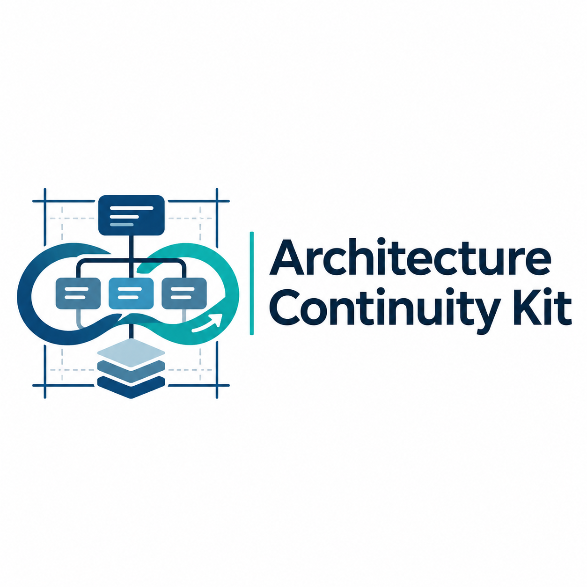

<div align="center">
  

  <h1>Architecture Continuity Kit</h1>

  <p>
    <strong>Keeping large AI projects understandable as they evolve.</strong>
  </p>
</div>


# Architecture Continuity Kit

**A small starter for keeping a growing AI/software project understandable.**
No external Python packages are required. Python 3.11+ is needed.

The point is not to automate understanding. It is to make architectural
assumptions explicit, check a limited subset automatically, and keep
uncertainties and next decisions visible to humans and AI assistants.

## Three commands

```bash
python scripts/archcheck.py check
python scripts/archcheck.py report
python scripts/archcheck.py impact demo/core/domain.py
```

For a Git repository, compare a branch against a base (use a base ref you have locally):

```bash
python scripts/archcheck.py impact --base origin/main
```

The result is **potential impact**, not proof of a runtime dependency.

Run the unit tests:

```bash
python -m unittest discover -s tests -v
```

## What's inside

- `architecture.toml`: concise, reviewable description of component purpose,
  ownership, dependency permissions and evidence pointers.
- `scripts/archcheck.py`: checks file existence, declared cycles and a subset of
  forbidden static Python imports; generates a Mermaid diagram and impact summary.
- `docs/ARCHITECTURE.generated.md`: reproducible **declared** component view.
- `docs/INVARIANTS.md`: protected properties, with enforcement and limitations.
- `docs/decisions/`: small architecture decision records (ADRs).
- `docs/PROJECT_STATE.md`: handoff card for humans and AI coding agents.
- `.github/pull_request_template.md`: keeps architectural consequences in reviews.
- `.github/workflows/architecture-check.yml`: basic continuous check.
- `prompts/ARCHITECT_REVIEW.md`: an AI review prompt that separates verified,
  inferred and intended claims.
- `demo/` and `tests/`: harmless runnable illustration, not a production app.

## Adapt it to a real project (about 30 minutes for the first pass)

1. Replace the example `demo` packages with your actual component directories.
2. Record each component's **purpose**, **owner**, **permitted dependencies** and
   **test/trace evidence** in `architecture.toml`.
3. Replace the example tests with your real tests. Record crucial invariants.
4. Run the checker and commit the generated diagram with your changes.
5. In each PR, ask what changed architecturally, not only which lines changed.
6. Periodically compare declared architecture with runtime tracing, repository
   searches and an independent, evidence-grounded AI review.

## Honest limits and extensions

- The checker uses Python AST to catch only statically visible imports between
  declared components. It **does not** capture reflection, dependency injection,
  network service calls, agent tool use, full dataflows or semantic behavior.
- For a serious Python codebase, use Import Linter for stronger boundary contracts;
  for JS/TS, consider dependency-cruiser. They require separate integration.
- For complex diagrams, model the architecture in Structurizr DSL (C4).
- For agent runtime behavior, use OpenTelemetry/OpenInference tracing and,
  optionally, a local Phoenix instance. Do not capture private prompts, data,
  or model outputs indiscriminately.
- A recorded test path or citation is not proof that tests passed or claims are true.
  Review actual results and trace links.
- `docs/PROJECT_STATE.md` is manual. Update it after meaningful changes and handoffs.
- GitHub Actions is a suggested check; enforce branch protection as appropriate.

## The rule

**Every significant change should leave the system easier, not harder, to explain.**
