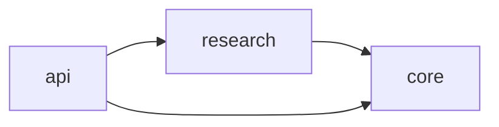

# Architecture map (generated)

> DECLARED structure from `architecture.toml`; file and import checks are
> performed separately by `archcheck.py`. A diagram is not runtime proof.

**Project:** Architecture Continuity Kit (example)

**Mission:** A tiny AI-project-shaped example with explicit architectural boundaries.

## Components

| Component | Responsibility | Owner | Declared dependencies | Evidence pointers |
| --- | --- | --- | --- | --- |
| `core` | Domain types and policy; independent of other components. | Core team | None | `tests/test_demo.py`, `docs/INVARIANTS.md` |
| `research` | Research logic built on domain primitives. | Research team | core | `tests/test_demo.py` |
| `api` | Presentation-facing adapter; no logic duplicated from research. | Application team | research, core | `tests/test_demo.py` |

## Declared component graph

## Reading this map

An arrow `A --> B` means A is **allowed/expected** to depend on B.
The AST checker catches some forbidden Python imports; it cannot prove
that all runtime links are captured. Compare this declared view with
runtime traces and repository evidence before making strong claims.
